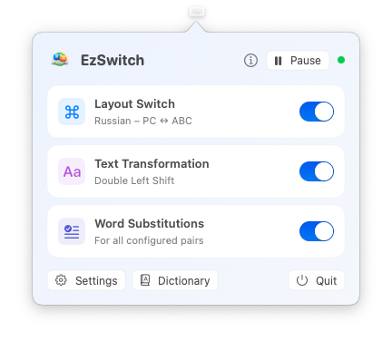
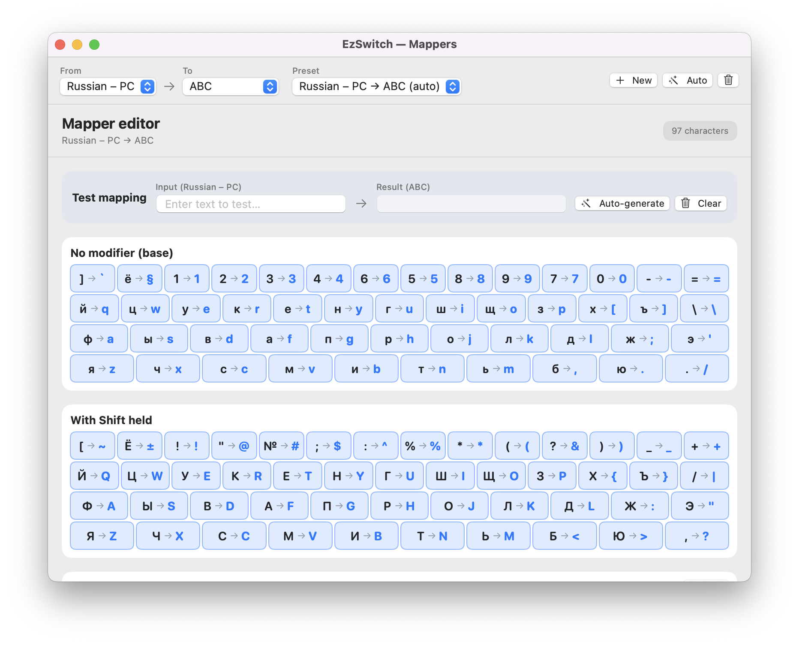
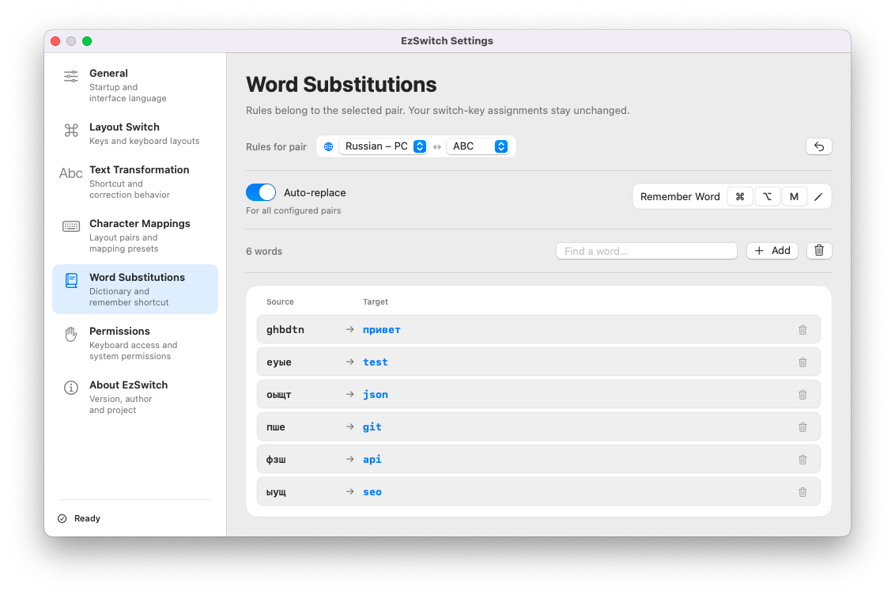

# EzSwitch

A macOS menu bar app for switching keyboard layouts, correcting text typed in the wrong layout, and replacing words from your own dictionary.

<p align="center">
  
</p>

## Features

- **Layout switching:** tap Left or Right Command to select the layout assigned to that key. You can use Option instead. Normal shortcuts such as ⌘C and ⌘V still work.
- **Text correction:** double-tap your configured Shift or Option key to convert selected text or the last word, for example `ghbdtn → привет` or `руддщ → hello`.
- **Word substitutions:** add pairs such as `пше → git`; EzSwitch replaces matching words as you type, preserving their case.
- **Custom mappings:** generate conversion rules from installed keyboard layouts or edit individual characters and text rules.
- **Terminal support:** correct newly typed text in Terminal.app and iTerm2, including compatible CLI prompts.

Requires **macOS 14 or later**. Release downloads support **Apple Silicon and Intel** Macs. The interface is available in English, Russian, Ukrainian, Hebrew, German, French, Spanish, and Polish.

## Installation

1. Download `EzSwitch.dmg` or `EzSwitch.zip` from [GitHub Releases](https://github.com/alexrel/EzSwitch/releases).
2. Open the DMG or unpack the ZIP, then move `EzSwitch.app` to **Applications**.
3. Launch EzSwitch. A keyboard icon appears in the menu bar.
4. In **System Settings → Privacy & Security**, enable EzSwitch under both **Input Monitoring** and **Accessibility**. These permissions allow it to detect shortcuts and replace text in other apps.
5. Restart EzSwitch after granting permissions. You can check their status and restart from **Settings → Permissions**.

The release is not notarized by Apple. If macOS blocks the first launch, use **System Settings → Privacy & Security → Open Anyway**.

## Getting started

Click the keyboard icon and open **Settings** (or press **⌘,** while EzSwitch is active). The menu bar panel lets you toggle each feature or **Pause** the app without changing saved preferences.

In **General**, choose whether EzSwitch launches at login and which interface language it uses. Changing the interface language does not change your keyboard layouts.

### Layout switching

1. Open **Layout Switch** and enable the feature.
2. Choose **Command** or **Option** under **Modifier key**.
3. Assign a layout to the **Left key** and another to the **Right key**.

For example, assign Russian to Left Command and ABC to Right Command. Tap either key on its own to switch directly to that layout. Both the panel and settings sidebar show the selected modifier’s icon.

### Correcting text

In **Text Transformation**, select the double-tap key: Left, Right, or either Shift/Option. Select some text, or leave the cursor after the word you want to fix, then double-tap that key.

- Enable **Switch to the result layout after correction** to continue typing in the corrected layout.
- Enable **Do not pass the double tap to other apps** if the same gesture opens another action, such as Search Everywhere in JetBrains IDEs.
- With mappings connecting a third language to your primary pair, repeated corrections can cycle through the primary layouts and back to the original text.

### Character mappings

Mappings define how text converts between a pair of keyboard layouts.

1. Open **Character Mappings** and choose the layout pair.
2. Use **Auto-generate** to fill the mapping from your installed layouts, or **New** to create a preset. Choose the preset to use under **Active preset**.
3. Click a key on the visual keyboard to edit its output. Use the Shift layer or extra text rules where needed.
4. Try both conversion directions in **Test mapping**. Changes save automatically.

<p align="center">
  
</p>

### Word substitutions

1. Open **Word Substitutions**, or **Dictionary** from the menu bar panel.
2. Choose a layout pair and add a source word and its replacement, for example `пше → git`.
3. Type the source word followed by Space, Enter, Tab, or punctuation to replace it. Each entry can also switch to the replacement’s layout.

The configurable **Remember Word** shortcut saves a typed or selected word as a substitution and replaces it in place. Set the shortcut using **Remember Word** in the dictionary header.

Substitutions are directional: `пше → git` does not also replace `git → пше`. Automatic substitutions apply to all configured pairs; the editor shows the selected pair.

<p align="center">
  
</p>

## Terminals and CLI tools

In **Terminal.app and iTerm2**, including compatible Codex CLI and Claude Code prompts, EzSwitch keeps the last observed typed fragment in memory. Correction deletes that fragment with Backspace and pastes the converted text, temporarily using the clipboard. Manual correction works even when automatic word substitutions are disabled.

Cursor movement, mouse clicks, shortcuts, and app changes clear the fragment. Pasted text, text recalled from command history, and text typed before monitoring began are not reconstructed. Secure Keyboard Entry prevents correction; arbitrary TUI command modes and embedded IDE terminals are not covered.

Debug diagnostic logs may contain the text being transformed.

## Compatibility

On macOS 15.4 and later, Apple keyboard layout names follow EzSwitch’s interface language. On macOS 14–15.3, they use system-provided names and do not change when you switch the app’s interface language. Layout switching and replacement rules work the same way.

## Build from source

Use **Xcode 16.3 or later**:

```bash
git clone https://github.com/alexrel/EzSwitch.git
cd EzSwitch
./build.sh app
```

The app is written to `build/Release/EzSwitch.app`.

[AlexReL](https://github.com/alexrel) · [MIT License](LICENSE)
