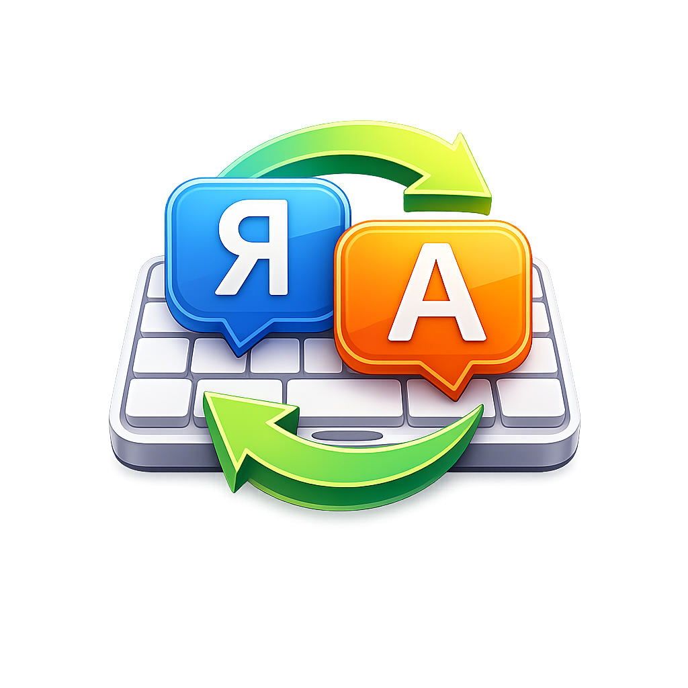
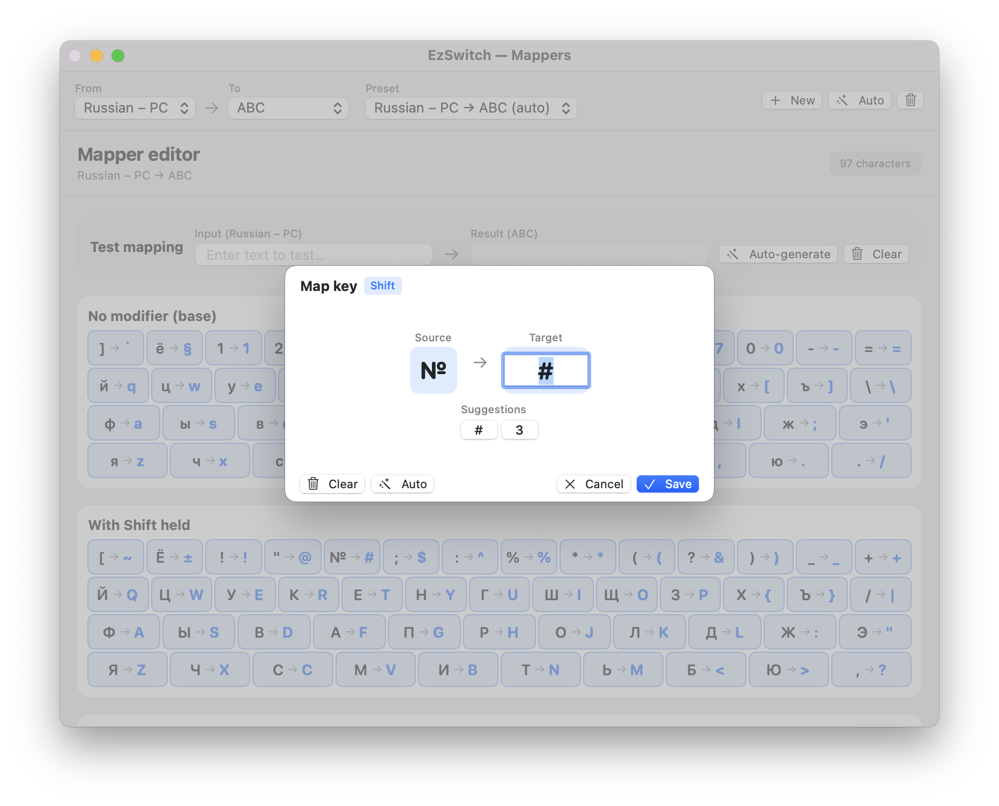

# EzSwitch

<p align="center">
  
</p>

<p align="center">
  <strong>A macOS menu bar utility for keyboard layout switching, text transformation, and smart word substitution</strong>
</p>

<p align="center">
  Inspired by Caramba Switcher, Punto Switcher, and Karabiner-Elements
</p>

<p align="center">
  
</p>

## Features

### Command / Option Key Layout Switching
- Press **Left Command** key → switch to Left layout (configurable)
- Press **Right Command** key → switch to Right layout (configurable)
- Works as a quick single tap (holding the key for shortcuts like `⌘C` / `⌘V` does not switch layouts)
- **Works with any pair of languages**, not just Russian and English
- The modifier family (**Command** or **Option**) is selectable from the **Key** dropdown
- **Order-independent language pair**: swapping Left and Right languages keeps the exact same active preset, character mappings, and word substitutions

### Text Transformation
- Double-tap **Shift** (or **Option**) to transform selected text or the last typed word between keyboard layouts
- Automatically detects the source language of the text and converts it to the opposite layout in your pair (`ghbdtn` ↔ `привет`)
- Supports various trigger combinations:
  - Double Left / Right Shift
  - Double Left / Right Option
  - Double any Shift / Option
  - **Hold one Shift + double-tap the other** — transforms text without switching the active keyboard layout
- **Suppress in apps** toggle — blocks the double-tap from reaching apps where it triggers unwanted actions (e.g. JetBrains IDEs' *Search Everywhere* on double Shift)
- **Switch layout after** — automatically switches the active input source to match the transformed text

### Smart App Detection
- Automatically detects the frontmost application (`AppConfigRegistry`)
- Uses the appropriate word selection shortcut (`⌥⇧←` for native macOS apps, `⌃⇧←` for JetBrains IDEs, VS Code, Cursor, Zed, Windsurf, Sublime Text, Terminal apps, etc.)

### Customizable Keyboard Mappers (`Character Mappings`)
- **Unified Bidirectional Language Pair (`Russian – PC ↔ ABC`)** — one shared mapping and preset list per language pair regardless of which layout is assigned to Left or Right Command
- **Auto-generated** mappings via Apple's `UCKeyTranslate` Carbon API: select two layouts and click **Auto** (`✨`) to build a complete mapping from the system key code tables
- **Tactile Dual-Legend Visual Keyboard** — styled after Apple Magic Keyboard dual-legend keycaps (source character in top-left, mapped target character in bottom-right, with LED-lit `Shift` modifier caps); click any key to customize
- **Multi-character targets** — a single source key can map to a sequence (e.g. `й → "ja"`, `ц → "tz"`, emoji, or symbols)
- **Automatic reverse direction** — store only one preset per language pair; the opposite direction is rebuilt via longest-match (`TextTransformer.applyReverse`)
- **Confirmation guards** — clicking **Auto** (`✨`), **Clear all keys** (`🧹`), or **Delete preset** (`🗑`) prompts for confirmation before overwriting or deleting custom mappings
- **Live bidirectional test bar** — test your mapping in either direction directly above the keyboard without risking your saved keys
- Presets are stored in `~/Library/Application Support/EzSwitch/presets.json`

### Smart Word Substitutions (`Word Substitutions`)
- **Automatic word-level replacement** — teach EzSwitch words that you frequently mistype in the wrong layout (e.g. `пше → git`, `да ↔ lf`); as soon as you type a word (2+ characters) followed by Space, Enter, Tab, or punctuation, it is replaced in place
- **Case preservation** — `ПШЕ` → `GIT`, `Пше` → `Git`, `пше` → `git`
- **Configurable Remember Hotkey** (default **⌘⇧M**) — type a word (or select an existing word) in any app and press the hotkey: EzSwitch converts the word in place **and** saves the substitution to your dictionary
- **Save both ways** — both the **Add Word** and **Edit Word** dialogs include a *"Save both ways (also adds/updates the reverse)"* toggle so bidirectional pairs stay in sync
- **Layout stays put** — replacements are delivered via the clipboard without changing your active keyboard layout
- **Unified per-pair list** — all word substitutions for `Russian – PC ↔ ABC` live in a single unified table regardless of Left/Right Command order
- Stored in `~/Library/Application Support/EzSwitch/word_mappings.json`

#### Mapper Editor — Visual Keyboard Layout
The editor shows a 48-key QWERTY grid (4 rows × 14/13/11/10 keys) with decorative modifier keys (`Tab`, `Caps Lock`, `Return`, `Shift`). Each key displays its base and Shift-state mapping.

| Row | Position | Key (ID) | Virtual Key Code (hex) | Notes |
|-----|----------|----------|------------------------|-------|
| 1 | 1 | backtick | `0x32` | EN: `` ` `` `~` / RU: `ё` `Ё` |
| 1 | 2 | section  | `0x0A` | EN: `§` `±` / RU: `ё` `Ё` |
| 1 | 3 | 1 | `0x12` | EN: `1` `!` / RU: `1` `!` |
| 1 | 4 | 2 | `0x13` | EN: `2` `@` / RU: `2` `"` |
| 1 | 5 | 3 | `0x14` | EN: `3` `#` / RU: `3` `№` |
| 1 | 6 | 4 | `0x15` | EN: `4` `$` / RU: `4` `;` |
| 1 | 7 | 5 | `0x16` | EN: `5` `%` / RU: `5` `%` |
| 1 | 8 | 6 | `0x17` | EN: `6` `^` / RU: `6` `:` |
| 1 | 9 | 7 | `0x1C` | EN: `7` `&` / RU: `7` `?` |
| 1 | 10 | 8 | `0x19` | EN: `8` `*` / RU: `8` `*` |
| 1 | 11 | 9 | `0x1A` | EN: `9` `(` / RU: `9` `(` |
| 1 | 12 | 0 | `0x1D` | EN: `0` `)` / RU: `0` `)` |
| 1 | 13 | minus | `0x1B` | EN: `-` `_` / RU: `-` `_` |
| 1 | 14 | equal | `0x18` | EN: `=` `+` / RU: `=` `+` |
| 2 | 1 | q | `0x0C` | |
| 2 | 2 | w | `0x0D` | |
| 2 | 3 | e | `0x0E` | |
| 2 | 4 | r | `0x0F` | |
| 2 | 5 | t | `0x11` | |
| 2 | 6 | y | `0x10` | |
| 2 | 7 | u | `0x20` | |
| 2 | 8 | i | `0x22` | |
| 2 | 9 | o | `0x1F` | |
| 2 | 10 | p | `0x23` | |
| 2 | 11 | lbracket | `0x21` | EN: `[` `{` / RU: `х` `Х` |
| 2 | 12 | rbracket | `0x1E` | EN: `]` `}` / RU: `ъ` `Ъ` |
| 2 | 13 | backslash | `0x2A` | EN: `\` `\|` / RU: `\` `/` |
| 3 | 1 | a | `0x00` | |
| 3 | 2 | s | `0x01` | |
| 3 | 3 | d | `0x02` | |
| 3 | 4 | f | `0x03` | |
| 3 | 5 | g | `0x05` | |
| 3 | 6 | h | `0x04` | |
| 3 | 7 | j | `0x26` | |
| 3 | 8 | k | `0x28` | |
| 3 | 9 | l | `0x25` | |
| 3 | 10 | semicolon | `0x29` | EN: `;` `:` / RU: `ж` `Ж` |
| 3 | 11 | quote | `0x27` | EN: `'` `"` / RU: `э` `Э` |
| 4 | 1 | z | `0x06` | |
| 4 | 2 | x | `0x07` | |
| 4 | 3 | c | `0x08` | |
| 4 | 4 | v | `0x09` | |
| 4 | 5 | b | `0x0B` | |
| 4 | 6 | n | `0x2D` | |
| 4 | 7 | m | `0x2E` | |
| 4 | 8 | comma | `0x2B` | EN: `,` `<` / RU: `б` `Б` |
| 4 | 9 | period | `0x2F` | EN: `.` `>` / RU: `ю` `Ю` |
| 4 | 10 | slash | `0x2C` | EN: `/` `?` / RU: `.` `,` |

## Requirements

- **macOS 15.4 or later**
- **Xcode 15.0 or later** (if building from source)

## Permissions

EzSwitch requires two macOS permissions to monitor keys and replace text:

1. **Input Monitoring** — to detect single modifier taps, double Shift/Option taps, and typed word boundaries
2. **Accessibility** — to transform selected text and perform automatic word replacements

To grant permissions:
1. Open **System Settings** → **Privacy & Security** → **Input Monitoring** and enable **EzSwitch**
2. Open **System Settings** → **Privacy & Security** → **Accessibility** and enable **EzSwitch**
3. Click **Restart** inside the EzSwitch popover (or relaunch the app)

## Installation

### Option A: Install Pre-Built Release (`EzSwitch.dmg` or `EzSwitch-Portable.zip`)
1. Download `EzSwitch.dmg` or `EzSwitch-Portable.zip` from the [Releases](https://github.com/alexrel/EzSwitch/releases) page
2. Drag `EzSwitch.app` into your `/Applications` folder
3. Because the portable release uses an ad-hoc signature (without paid Apple notarization), macOS Gatekeeper may show an *"unidentified developer"* prompt on first launch:
   - Either go to **System Settings → Privacy & Security** and click **Open Anyway**
   - Or clear the quarantine attribute in Terminal:
     ```bash
     xattr -cr /Applications/EzSwitch.app
     open /Applications/EzSwitch.app
     ```
4. Grant **Input Monitoring** and **Accessibility** permissions when prompted

### Option B: Build from Source
1. Clone the repository:
   ```bash
   git clone https://github.com/alexrel/EzSwitch.git
   cd EzSwitch
   ```
2. Build the project:
   ```bash
   ./build.sh
   ```
3. Install to `/Applications`:
   ```bash
   rm -rf /Applications/EzSwitch.app && cp -R build/Release/EzSwitch.app /Applications/ && open /Applications/EzSwitch.app
   ```

## Usage

1. Launch **EzSwitch** — a keyboard icon (`⌨️`) appears in your macOS menu bar
2. Click the icon to open the **EzSwitch Settings** popover:
   - **Layout Switch**: enable single-tap switching, choose **Command** or **Option**, and pick the layouts for **Left** and **Right**
   - **Text Transformation**: choose the double-tap trigger key, toggle **Suppress in apps**, and toggle **Switch layout after**
   - **System**: enable **Launch at login**, open **Keyboard Mappers**, or switch the active **Preset** directly from the popover
   - **About (`ⓘ`)**: click the `ⓘ` icon in the header or `EzSwitch v1.0 • by AlexReL` in the footer to view version, build, author info, and the GitHub repository link

### Configuring Mappers (`Character Mappings`)

1. Open EzSwitch settings → **Keyboard Mappers** → **Open**
2. Select your language pair at the top (`Russian – PC ↔ ABC`)
3. In the **Mapper editor** header:
   - Use the **Preset** dropdown to switch between saved presets for the pair
   - Click **+ New** to create a custom preset
   - Click **Auto** (`✨`) to automatically populate all keys from the installed macOS keyboard layouts via `UCKeyTranslate`
   - Click **Clear all keys** (`🧹`) to reset keys in the current preset, or **Delete preset** (`🗑`) to remove the preset
4. Click any keycap on the virtual keyboard (Base or `⇧ Shift` layer) to customize its target character or multi-character string

   <p align="center">
     
   </p>

   <p align="center">
     
   </p>

5. Use the **Test mapping** bar to preview transformations in either direction in real time

### Configuring Word Substitutions (`Word Substitutions`)

1. Switch to the **Word Substitutions** tab in the Mappers window
2. **Quick training via Hotkey**: type a word in any app (e.g. `пше`) or select a word, then press **⌘⇧M** (customizable by clicking the hotkey badge in the header). EzSwitch replaces the word with `git` in place and saves `пше → git` to your list
3. **Manual entry**: click **+ Add** to add a custom word pair. Enable **Save both ways** to automatically save the reverse direction as well
4. **Editing & Deleting**: click **Edit** (or double-click any row) to modify the source/target word or toggle **Save both ways**; click `✕` to delete an entry

## Architecture

The application is written in Swift & SwiftUI (`EzSwitch/*.swift`):

- **`AppDelegate`**: Application lifecycle, accessory activation policy (menu bar only), and initial permission checks
- **`StatusBarController`**: Manages the `NSStatusItem` and transient `NSPopover` hosting `SettingsView`
- **`KeyboardManager`**: Monitors global key events via `CGEvent.tapCreate`, tracks single modifier taps, double-tap transform triggers, and live word buffering (`UCKeyTranslate` key-code translation) for automatic word substitutions
- **`TextTransformer`**: Transforms selected text or the last word before the cursor using the active `LayoutMapperPreset` (auto-detecting direction and rebuilding reverse mappings via longest-match)
- **`ClipboardManager`**: Preserves and restores the system `NSPasteboard` around synthetic `⌘C` / `⌘V` operations
- **`SettingsManager`**: Persists user settings in `UserDefaults`, including order-independent active preset selection (`selectedPresetId(for:_:)`)
- **`AppConfigRegistry`**: Per-application word selection shortcuts (`⌥⇧←` vs `⌃⇧←`) with bundle ID and keyword matching
- **`MapperStore`**: Thread-safe JSON store (`presets.json`) for `LayoutMapperPreset` models with bidirectional pair matching and first-launch auto-seeding
- **`WordMapperStore` & `WordMatcher`**: Unified per-pair JSON store (`word_mappings.json`) and case-preserving matcher for word-level substitutions
- **`MapperSettingsView` / `MapperEditorView` / `WordSubstitutionView`**: Unified SwiftUI mapper window with tactile dual-legend keyboard keycaps and word substitution table
- **`Constants`**: Centralized constants for key codes, modifier masks, timing intervals, UserDefaults keys, and minimum word replacement length (`Constants.WordSub.minAutoReplaceLength`)

## Building & Distribution

### Dual-Target `build.sh` (Local Dev + Portable Release)

Running `./build.sh` produces two types of artifacts:

1. **Local Development App (`build/Release/EzSwitch.app` and `./EzSwitch.app`)**
   - Automatically signed with your local Keychain certificate (`Apple Development` or self-signed `EzSwitch Local Dev`) so macOS TCC remembers your **Accessibility** and **Input Monitoring** permissions across rebuilds.
   - To set up a stable local certificate once, run:
     ```bash
     ./scripts/setup_dev_signing.sh
     ```
2. **Portable Distribution Artifacts (`build/EzSwitch.dmg`, `build/EzSwitch-Portable.zip`, `build/Portable/EzSwitch.app`)**
   - Automatically re-signed with a universal **ad-hoc signature (`--sign -`)** without personal Team ID restrictions, so the DMG and ZIP can be shared on GitHub Releases and launched on any other Mac.

```bash
# Build local app + portable ZIP + DMG (default)
./build.sh

# Build app only
./build.sh app

# Build DMG only (from existing .app)
./build.sh dmg [path/to/EzSwitch.app]
```

### Versioning

EzSwitch follows Semantic Versioning with automated build numbering:
- **Marketing Version** (`CFBundleShortVersionString`): Stored in `EzSwitch/Info.plist`. To inspect or bump the version across the project:
  ```bash
  # Check current version & build number
  ./scripts/bump_version.sh

  # Bump marketing version
  ./scripts/bump_version.sh 1.2.0
  ```
- **Build Number** (`CFBundleVersion`): Automatically derived from the Git commit count (`git rev-list --count HEAD`) on every build.
- **Git Commit Hash**: Embedded into the app bundle's `Info.plist` and displayed in the **About** popover (`v1.1.0 (build 4 · f3c94bd)`).

## Author

**AlexReL** — [github.com/alexrel](https://github.com/alexrel)

## License

This project is licensed under the MIT License — see the [LICENSE](LICENSE) file for details.
